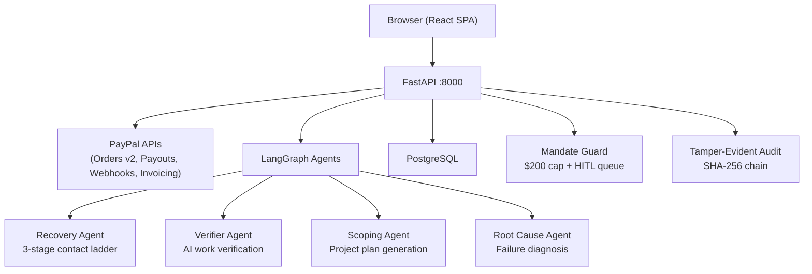

# ProofPay 🛡️

> **AI-powered freelance escrow & autonomous revenue recovery — built on PayPal APIs**
> *PayPal AI Hackathon 2026 Submission*

ProofPay combines two engines:
- **Engine 1 — PREVENT:** Milestone-based escrow with dual cryptographic plan approval, AI work verification, Mandate Guard policy gating, and PayPal Payouts
- **Engine 2 — RECOVER:** Autonomous failed-payment recovery via 3-stage contact ladder, 3-way reconciliation, and root-cause diagnosis

---

## 🚀 Quick Start

```bash
# 1. Clone
git clone https://github.com/your-org/proofpay.git
cd proofpay

# 2. Install Python deps
pip install -r requirements.txt

# 3. Configure environment (copy and fill in PayPal sandbox credentials)
cp .env.example .env

# 4. Build the React frontend
cd frontend/react-app
npm install
npm run build
cd ../..

# 5. Start the server (serves API + React SPA on port 8000)
uvicorn backend.app.main:app --port 8000

# 6. Open your browser
# http://localhost:8000       → React SPA
# http://localhost:8000/docs  → Swagger API docs
```

> **Dev mode (hot reload):**
> ```bash
> # Terminal 1 — FastAPI
> uvicorn backend.app.main:app --port 8000 --reload
> # Terminal 2 — Vite (proxies /api to :8000)
> cd frontend/react-app && npm run dev
> # Open http://localhost:5173
> ```

---

## 🏗️ Architecture



---

## 🎬 7 End-to-End Demo Flows

| Flow | Description | Key Endpoints |
|---|---|---|
| **A** | Create project → dual approval → PayPal fund | `POST /projects`, `POST /projects/{id}/approve`, `POST /projects/{id}/fund` |
| **B** | Submit milestone work → AI verification → payout | `POST /milestones/{id}/submit`, `GET /milestones/{id}/submission` |
| **C** | Mandate Guard blocks oversized payout → HITL | `GET /submission-approvals`, `POST /submission-approvals/{id}/decide` |
| **D** | Inject payment failure → recovery agent activates | `POST /demo/inject-failure`, `GET /cases/{id}` |
| **E** | Advance clock → escalate through 3 contact stages | `POST /demo/advance-clock`, `GET /cases` |
| **F** | Paid-elsewhere reconciliation → outreach blocked | `GET /reconciliation/summary` |
| **G** | Run 150-case benchmark → see 28.67% vs 8% | `POST /demo/run-simulator`, `GET /eval/latest` |

---

## 📊 Benchmark Results

| Metric | Agent (ProofPay) | Baseline | Delta |
|---|---|---|---|
| Recovery Rate | **28.67%** | 8.00% | **+20.67 pp** |
| Cases Recovered | **43 / 150** | 12 / 150 | **+31 cases** |
| Amount Recovered | **$11,010** | $2,560 | **+$8,450** |
| Wrongful Contacts | **0%** | 0% | 0 |
| Revenue Multiplier | **3.58×** | 1.0× | — |

---

## 💳 PayPal API Usage

| API | Usage in ProofPay |
|---|---|
| **Orders v2** | Escrow funding — client creates PayPal order, captures on approval |
| **Payouts** | Milestone release — freelancer receives payout on AI verification pass |
| **Webhooks** | `PAYMENT.CAPTURE.COMPLETED`, `PAYMENT.PAYOUTS-ITEM.SUCCEEDED` → state transitions |
| **Invoicing** | Generate and track overdue invoices for recovery cases |

---

## 🛡️ Human-in-the-Loop (HITL)

ProofPay enforces **Mandate Guard** — an AI policy layer that:
- **Caps autonomous payouts at $200** — anything above routes to the HITL approval queue
- **Respects quiet hours (21:00–08:00)** — no outreach during off-hours
- **Blocks paid-elsewhere cases** — 3-way reconciliation prevents wrongful contacts
- Every HITL decision is logged in the **tamper-evident SHA-256 audit chain**

---

## 🤖 AI Agents

| Agent | Framework | Role |
|---|---|---|
| Recovery Agent | LangGraph | 3-stage contact ladder, state machine |
| Verifier Agent | LangGraph | AI work verification for milestone submissions |
| Scoping Agent | LangGraph | Project plan generation with SHA-256 hash |
| Root Cause Agent | LangGraph | Failure code diagnosis for payment failures |

---

## 📁 Project Structure

```
proofpay/
├── backend/
│   ├── app/
│   │   ├── main.py          # FastAPI app — serves React build on /
│   │   ├── api/             # Route handlers (projects, cases, submissions…)
│   │   ├── agents/          # LangGraph agents (recovery, verifier, scoping)
│   │   ├── paypal/          # PayPal Orders, Payouts, Webhooks
│   │   └── core/            # Config, logging, Mandate Guard
│   └── scripts/
│       ├── ig1_gate.py      # IG-1 gate: 47/47 checks (import boundary)
│       └── ig2_gate.py      # IG-2 gate: 61/61 checks (OpenAPI contract)
├── frontend/
│   └── react-app/           # Vite + React 18 SPA
│       ├── src/
│       │   ├── pages/       # 25 page components
│       │   ├── components/  # Shared UI (Badge, Button, Card, DemoBar…)
│       │   └── api/         # API client + named endpoint helpers
│       └── dist/            # Production build (served by FastAPI)
├── contracts/
│   └── openapi.json         # OpenAPI 3.0 contract (30 paths)
├── data/
│   └── eval_report.json     # Benchmark: 28.67% vs 8%
└── postman/
    └── ProofPay.postman_collection.json
```

---

## 🔗 Links

- **API Docs:** http://localhost:8000/docs
- **Health Check:** http://localhost:8000/healthz
- **Demo Controls:** Use the sticky Demo Bar at the bottom of every page
